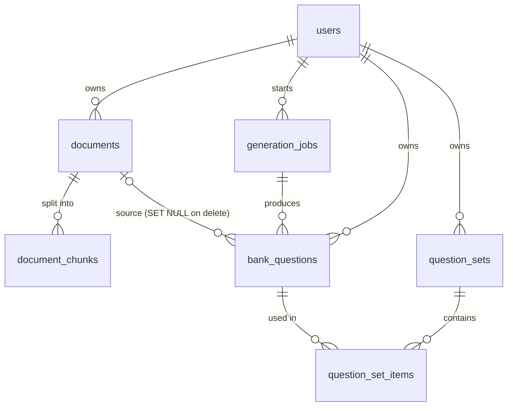
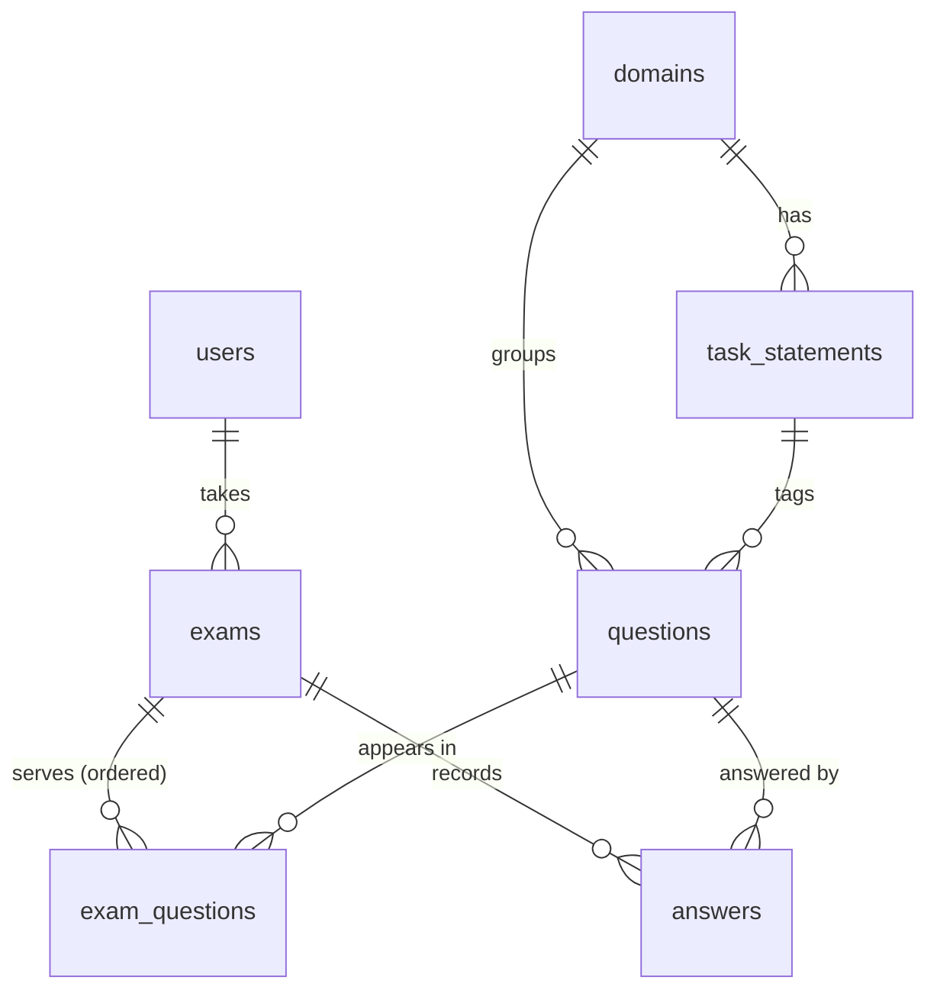

# Exam-Generator

An exam generator for teachers. Teachers upload PDFs; the API generates multiple-choice and true/false questions with answers, explanations and citations (file, page, line), verifies them automatically, and lets teachers save question sets and download printable PDFs. A smaller student module (timed AWS SAA-C03 practice exams) is kept.

This is a monorepo with a Python API, a Python queue worker and a React web app. The web app covers every endpoint, shown by role: teachers (documents, generation, question sets), students (practice sessions and timed exams, results, stats) and admins (users, samples, sources).

## Layout

```
apps/api/          Python / FastAPI service: HTTP, auth, queueing (see apps/api/README.md)
apps/worker/       Python queue worker: PDF text, embeddings, question generation (the heavy dependencies)
apps/web/          React + TypeScript app (Vite)
packages/core/     Python code shared by the API and the worker: settings, database models, storage, queue messages
packages/api-client/ OpenAPI schema and generated TypeScript client used by the web app
infra/terraform/   AWS infrastructure (ECS Fargate for API and worker, SQS, RDS pgvector, S3, Secrets Manager, ALB)
infra/local/       Local stand-ins (the SQS emulator's queue definitions)
docs/              PRDs, deployment guide, system design diagram
compose.yaml       PostgreSQL + pgvector and a local SQS (ElasticMQ) for development
justfile           One entry point for common tasks (`just` lists them)
.github/workflows/ CI
```

## Quick start

Prerequisites: [uv](https://docs.astral.sh/uv/), Docker with Compose, [just](https://github.com/casey/just), Node 24 and [pnpm](https://pnpm.io/).

```bash
just api-install                  # Python dependencies (API, worker and shared package)
cp apps/api/.env.example apps/api/.env       # then set JWT_SECRET_KEY
cp apps/worker/.env.example apps/worker/.env # then set ANTHROPIC_API_KEY yourself to generate questions
just db-up                        # PostgreSQL + pgvector + local queue
just migrate                      # schema + reference data
just seed                         # sample users (development only)
just api-dev                      # http://127.0.0.1:8000/docs

# in a second terminal: the worker (processes uploads and generation jobs from the queue)
just worker-dev

# in a third terminal
just js-install                   # JS dependencies
just web-dev                      # http://localhost:5173  (sign in as dave / teacher-pass, bob / builder, or alice / wonderland)
```

The web app talks to the API through the Vite dev proxy, so there is no CORS to configure. After changing an API endpoint or schema, run `just gen-client` and commit the regenerated `packages/api-client` files; CI fails if they are stale.

Without the worker running, uploads stay `pending`. Without `ANTHROPIC_API_KEY` on the worker, PDFs are still processed and generation jobs fail with a clear message.

Checks: `just check` (pyright, API tests, worker tests, JS typecheck, web tests). The walkthroughs for teachers and students, the configuration table and the project layout are in [`apps/api/README.md`](apps/api/README.md).

## Tools and models

| Area | What is used |
|---|---|
| API and worker | Python 3.14, FastAPI (API), Pydantic, SQLAlchemy 2 + Alembic, one uv workspace for `apps/api`, `apps/worker` and `packages/core` |
| Job queue | Amazon SQS with a dead-letter queue (ElasticMQ in development) |
| Database | PostgreSQL 17 with the pgvector extension (relational data and vectors in one database) |
| PDF text | pdfminer.six (text layer with page and line positions) |
| Embeddings | `BAAI/bge-small-en-v1.5` (384 dimensions) run locally with fastembed (ONNX), so no embedding API or GPU is needed |
| Question model | Anthropic Claude through the Anthropic API, `claude-sonnet-5-5` for both drafting and validation (`LLM_GENERATION_MODEL`, `LLM_VALIDATION_MODEL`) |
| Printable PDFs | ReportLab |
| File storage | A local folder in development, S3 on AWS |
| Auth | PyJWT access tokens, argon2 password hashes, rotating refresh tokens |
| Web | React 19, TypeScript, Vite, React Router, TanStack Query, generated OpenAPI client |
| Infra | Docker, Terraform (ECS Fargate, RDS, S3, Secrets Manager, ALB), GitHub Actions |

Without `ANTHROPIC_API_KEY` on the worker, everything works except generation, whose jobs fail with "Question generation is not configured".

## How PDFs become questions

The pipeline is retrieval-augmented: questions are written from excerpts of the teacher's own PDFs, never from the model's general knowledge, and every question has to point back to the lines it came from.

The API only accepts requests and puts a small message on a queue (SQS; ElasticMQ locally). The **worker** app takes the messages and does the heavy work, so the API image carries none of the PDF, embedding or LLM libraries and the embedding model is only baked into the worker image.

```
Browser -> API -> Postgres (rows: document pending, job queued)
              \-> S3 (the PDF) and SQS (message "ingest document 12")
Worker  <- SQS    -> reads the PDF from S3, writes chunks + embeddings to Postgres, calls Claude
```

**1. Ingestion** (worker, after `POST /documents`)
1. The API checks the upload (is a PDF, size under 25 MB), stores it and queues the work. The worker enforces the `PDF_MAX_PAGES` limit.
2. pdfminer.six extracts the text layer. Each non-empty text line is numbered 1, 2, 3... within its page. This is what "page and line" means in a citation. Scanned PDFs have no text layer and are rejected.
3. The lines are cut into **chunks** of 40 consecutive lines, each overlapping the previous one by 5, so a fact on a boundary appears whole in at least one chunk.
4. Each chunk is embedded locally (384-dimension vector) and saved in Postgres with its lines, as `[page, line, text]`, and the vector (HNSW index, cosine distance).
5. The document goes `pending` -> `processing` -> `ready`, or `failed` with a readable reason.

**2. Choosing excerpts** (when `POST /generations` runs)
- Without a `focus`, the question slots are spread evenly over all usable chunks of the selected documents, so the questions cover the whole text.
- With a `focus` (for example "photosynthesis"), the focus text is embedded and the nearest chunks by cosine similarity are used. This is the vector-search step of the RAG.
- Very short chunks are skipped, and the teacher's recent questions are passed along so the model does not repeat them.

**3. Drafting and checking** (one question "slot" at a time, up to 3 attempts per slot, each on a different chunk)
1. **Draft.** Claude gets one excerpt, with every line prefixed `[p12 l7]`, and is forced to answer through a tool call whose schema is validated by Pydantic: question, options, correct option, explanation and 1-3 citations (page, line range, quote copied word for word). The prompt says the excerpt is untrusted data, so instructions hidden in a PDF are ignored.
2. **Citation check (deterministic code, no model).** Each quoted text must appear in the cited lines of that chunk, ignoring case, whitespace and line-end hyphenation. Multiple-choice questions need four distinct options; true/false questions use A = True, B = False.
3. **Blind validation (second model call).** A fresh call sees the excerpt and the question but not the answer key. If it picks a different answer, or says the excerpt does not settle it or several options are defensible, the draft is dropped and the next attempt starts.
4. Only questions that pass all three steps are saved, with their citations stored as snapshots (document name, page, lines, quote) so they survive deleting the PDF.

The job ends `done` if at least one question was produced, otherwise `failed`. If a job asks for 10 questions and only 7 pass, you get 7.

**Limits to know about**
- Page and line numbers come from the extracted text layout. They match the printed page for ordinary text PDFs, but a PDF with front matter or unusual layout may number pages differently from the printed numbers.
- The checks show that the quote exists and that a second reading agrees with the answer. They do not replace a teacher reviewing the questions.

## Data model

One PostgreSQL database; the tables are defined in [`packages/core/exam_core/models.py`](packages/core/exam_core/models.py) and shared by the API and the worker. There are two separate question models: the teacher's generated **bank question** and the student module's fixture **question**. They are not linked.

### Teacher side: questions and question sets



**`bank_questions`**: one validated, generated question. Owned by a teacher; other teachers get 404.

| Field | Meaning |
|---|---|
| `type` | `mcq` (options A-D) or `true_false` (A = True, B = False) |
| `stem` | The question text |
| `options` | JSON object `{"A": "...", "B": "...", ...}` |
| `correct_option` | The key of the right option, one letter |
| `explanation` | Why that option is right, based on the excerpt |
| `citations` | JSON list of 1-3 snapshots: `{document, chunk_id, page, line_start, line_end, quote}`. They hold the file name and the quoted text, so they survive deleting the PDF |
| `validation` | What the blind check saw: `{blind_answer, ambiguous, reasoning}` |
| `model` | The model that wrote it |
| `document_id`, `job_id` | Where it came from; set to null if the document or job is deleted. The question stays |
| `owner_id`, `created_at` | Owner and creation time |

**`question_sets`** (`title`, `owner_id`, timestamps) and **`question_set_items`** (`set_id`, `question_id`, `position`) form a saved, ordered selection. The same question can be in many sets. Deleting a question removes it from its sets; deleting a set keeps the questions. A set renders to two PDFs: the student sheet (no answers or sources) and the teacher key (answers, explanations, page and line sources).

Upstream tables: **`documents`** (file name, size, SHA-256 unique per owner, `storage_key`, `page_count`, `status` `pending|processing|ready|failed`, `error`), **`document_chunks`** (`position`, `lines` as `[page, line, text]`, `content`, 384-dimension `embedding`) and **`generation_jobs`** (`document_ids`, `mcq_count`, `true_false_count`, `focus`, `status` `queued|running|done|failed`, `produced_count`, `error`).

### Student side: exams and practice



**`questions`**: the fixture bank (20 hand-written SAA-C03 questions): `domain_id`, `task_statement_id`, `stem`, `options` (A-D), `correct_option`, `explanation`, `cited_chunk_ids`, `validation`, `model` (`fixture`). `domains` (ids 1-4 with their exam weight) and `task_statements` (codes such as `1.1`) are the reference data.

**`exams`**: one exam or practice session of one student.

| Field | Meaning |
|---|---|
| `mode` | `exam` (timed) or `practice` (untimed, feedback after each answer) |
| `status` | `generating` -> `ready` -> `in_progress` -> `finished`, or `failed` (for example an empty bank) |
| `requested_question_count`, `question_count` | What was asked for and what was actually served (the bank may hold fewer) |
| `duration_minutes` | Exam mode only: 2 minutes per question |
| `started_at`, `ends_at`, `submitted_at` | Set on the server clock: `ends_at = started_at + duration`; the client clock is never trusted |
| `score` | Number of correct answers, set when finished (an expired exam is scored on next access) |

**`exam_questions`** (`exam_id`, `question_id`, `position`) is the ordered list of questions an exam serves. **`answers`** (`exam_id`, `question_id`, `selected_option`, `answered_at`, `is_correct`) holds one row per answered question; answering again overwrites it, and answers are rejected after `ends_at`. Deleting an exam deletes its question list and answers.

Visibility rules that follow from this: `GET /exams/{id}` never returns `correct_option` or `explanation` before results are unlocked (practice: always; exam: once finished or expired), and a student only sees their own exams.

### Exam sessions: the built-in exam in class

A teacher can open the built-in exam (its questions are code in `apps/api/app/sample_exam.py`, not table rows) to students for a fixed time. Three tables hold a session:

| Table | Fields |
|---|---|
| `exam_sessions` | `owner_id`, `exam_id` (`sample`), secret `join_token` (the link), `duration_minutes`, `started_at`, `ends_at` (= start + duration, server clock), `closed_at` (set if the teacher ends it early) |
| `session_participants` | `session_id`, `name` (unique per session), `token_hash` (SHA-256 of the secret the student's browser keeps), `joined_at`, `submitted_at`, `score` |
| `session_answers` | `participant_id`, `question_key` (`q1`...), `selected_option`, `answered_at`, `is_correct` (one row per answered question; answering again overwrites) |

Students need no account. They get their result when they submit; if they never do, they are scored on the answers saved so far once the session is over. The teacher's dashboard reads these tables (joined, submitted, scores, average, per-question correct rate).

## Docs

- [`docs/PRD-exam-generator.md`](docs/PRD-exam-generator.md): current requirements
- [`docs/PRD-aws-saa-study-assistant.md`](docs/PRD-aws-saa-study-assistant.md): the student module
- [`docs/DEPLOY.md`](docs/DEPLOY.md): deploying to AWS
